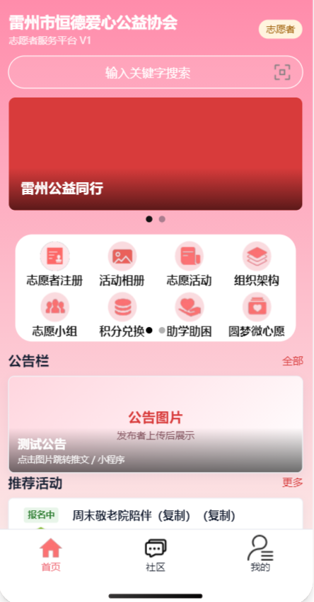
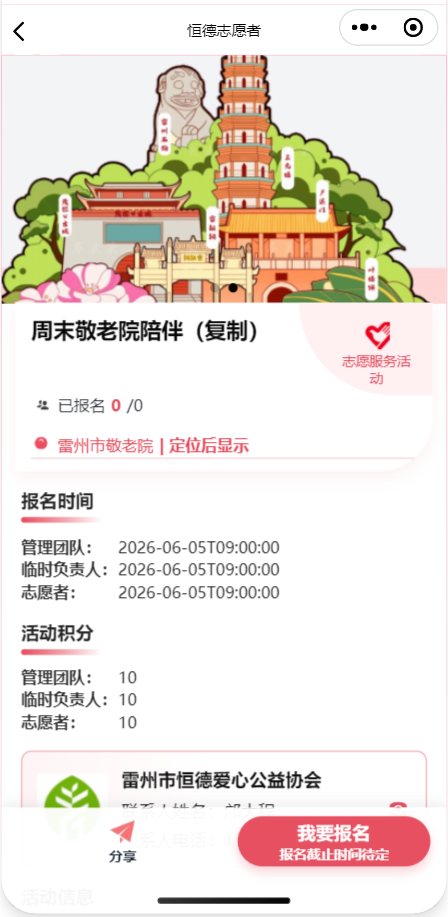
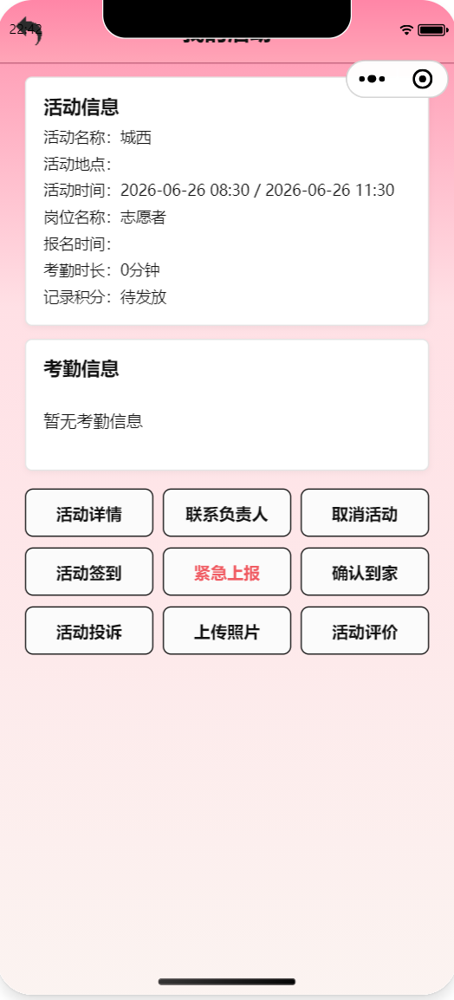
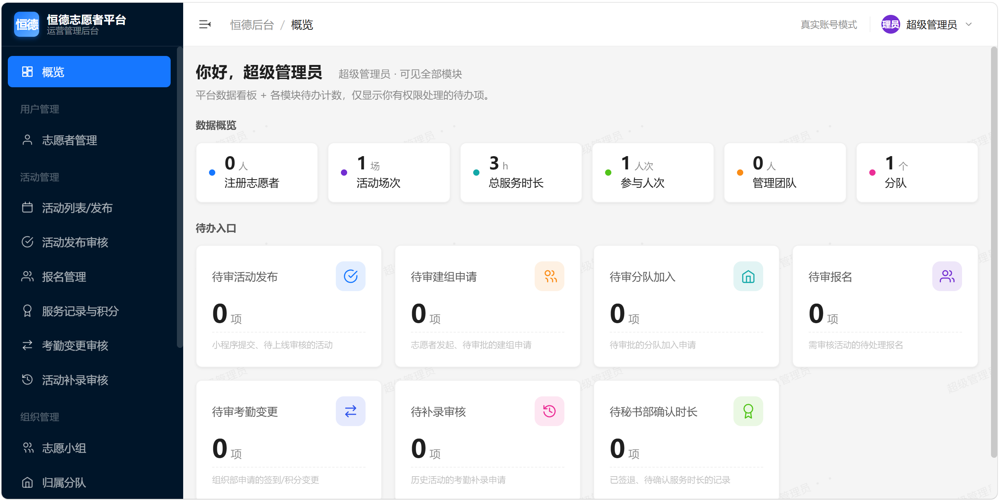
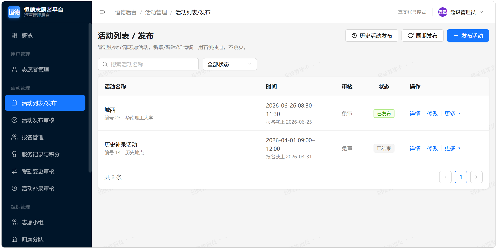
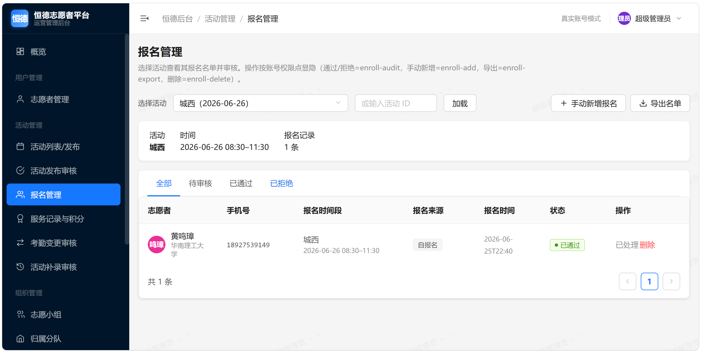
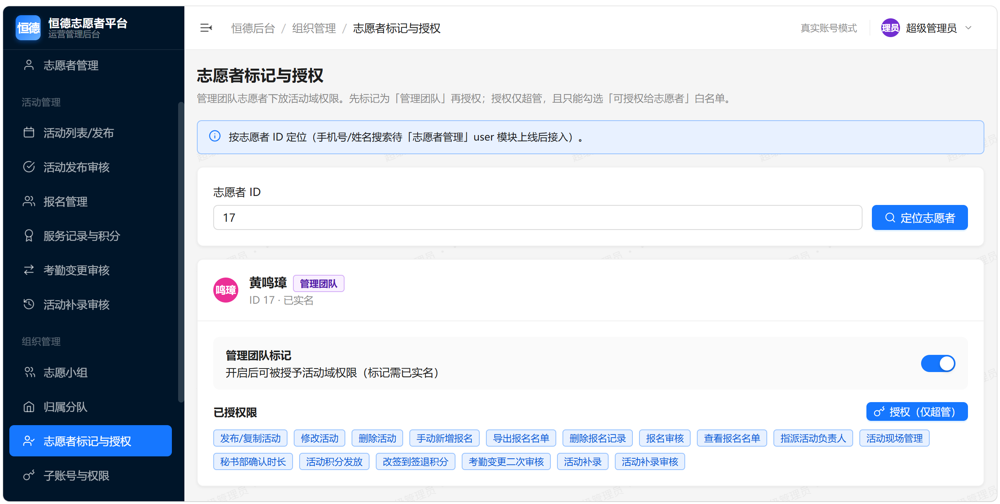
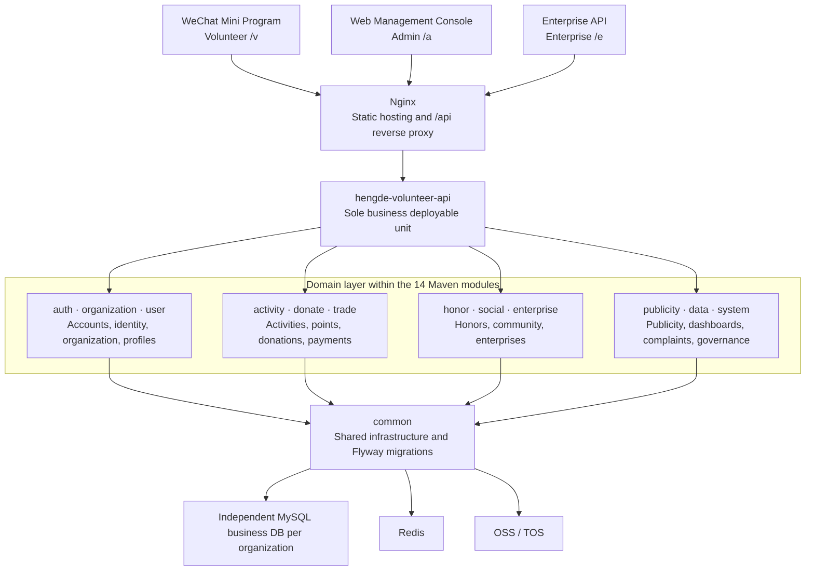

# Hengde Volunteer Management Platform

> A volunteer service system for non-profit organizations: a WeChat Mini Program for volunteers, a web-based management console, and a Spring Boot 4 modular-monolith backend.
>
> Designed and built for the Leizhou Hengde Charity Association. It covers real-name registration, organizational membership, activity publishing and per-slot enrollment, QR-code and GPS attendance, service hours and points, certificates and sanctions, charitable donations, community features, and public information.

<p>
  
  
  
  
  
  
  
  
</p>

**[中文版 README](README.md)** · English

---

## Table of Contents

- [Overview](#overview)
- [Preview](#preview)
- [Tech Stack](#tech-stack)
- [Architecture](#architecture)
- [Feature Coverage](#feature-coverage)
- [Engineering Practices](#engineering-practices)
- [Modules](#modules)
- [Getting Started](#getting-started)
- [Workspace Layout](#workspace-layout)
- [API and Project Documentation](#api-and-project-documentation)
- [Project Status](#project-status)

---

## Overview

The platform currently consists of three deliverable components:

| Component | Form | Users / Notes |
|---|---|---|
| Volunteer client | Native WeChat Mini Program | Guests, volunteers, temporary activity leaders, and management-team volunteers |
| Management console | Statically served React pages with no frontend build pipeline | Association departments, the board, and administrative sub-accounts |
| Business backend | Java 17 + Spring Boot 4 with 14 Maven modules | `hengde-volunteer-api` is the sole business deployable unit |

The main service flow is: **real-name registration → join a group or squad → per-slot enrollment → QR-code and GPS attendance → check-out and hour calculation → secretary confirmation → points ledger entry and certificate generation**.

The backend is a domain-oriented modular monolith. Multi-organization reuse follows a **white-label, multi-instance model**: each organization has its own business database and configuration while running the same api artifact. Existing business tables are not converted into shared-database multi-tenancy.

---

## Preview

### WeChat Mini Program (Volunteer Client)

| Home | Activity Details and Enrollment | GPS Check-in |
|:---:|:---:|:---:|
|  |  |  |

### Web Management Console

| Dashboard | Activity Management | Enrollment / Review | Sub-accounts and RBAC |
|:---:|:---:|:---:|:---:|
|  |  |  |  |

---

## Tech Stack

| Category | Technologies in Actual Use |
|---|---|
| Core framework | Java 17 · Spring Boot 4 · Maven Wrapper |
| Authentication and authorization | Sa-Token with separate volunteer `/v`, admin `/a`, and enterprise `/e` session realms |
| Persistence | MyBatis-Plus 3.5.16 · MySQL 8.0.17+ · HikariCP · Flyway |
| Cache and concurrency | Redis · Redisson · `DistributedLockSupport` |
| Object storage | Aliyun OSS / Volcengine TOS |
| Third-party capabilities | Volcengine SMS · Tencent Cloud identity verification · WeChat Mini Program and WeChat Pay · Kuaidi100 |
| Document processing | EasyExcel + Apache POI · iText · ZXing |
| API documentation | springdoc-openapi + Knife4j; disabled in production |
| Engineering | Lombok · Hutool · Spring `@Scheduled` · hand-written DTO / VO mapping |
| Testing | JUnit 5 · `@SpringBootTest` · Testcontainers MySQL / Redis; no H2 |
| Frontend | Native WeChat Mini Program · build-less React `createElement` admin console |
| Deployment | Nginx · systemd · environment-based configuration and production startup guards |

> Spring Cloud / Alibaba, Sentinel, MapStruct, XXL-Job, and MinIO may appear in historical plans or dependency management, but they are not used by the current code and are not part of the actual runtime stack.

---

## Architecture



**Architectural conventions:**

- The parent project manages dependencies; each domain module contains its own `controller / service / dao / entity / dto / vo` code.
- Domains collaborate through service interfaces rather than using another domain's Mapper directly.
- `common` owns shared infrastructure and business-database Flyway migrations; `api` owns bootstrap, route authentication, global configuration, and cross-domain aggregation.
- The supervision console is a separate application. Its V5 plan is complete but unimplemented, and it is not part of the current business Reactor.

---

## Feature Coverage

> A completed backend capability does not imply that its Mini Program pages are complete. The table separates those delivery boundaries; the knowledge-base domain pages remain the detailed source of truth.

| Domain | Main Capabilities | Current Coverage |
|---|---|---|
| Accounts and organization | Phone / password / WeChat login, identity verification and signed agreements, deactivation and restoration, groups, squads, org structure, forms, exams, RBAC | Backend and console implemented; major Mini Program flows use real APIs |
| Volunteer activities | Multi-slot publishing, recurring / historical activities, per-slot enrollment and cancellation, quotas, proxy enrollment, attendance, rosters, albums | Main flows implemented; complex activity editing and other remaining items are tracked in the domain backlog |
| Points and mall | Points ledger, points center, products and specifications, coupons, redemption, pickup / delivery, verification, enterprise points | Backend and console implemented; Mini Program mall pages remain incomplete |
| Donations and payments | Book donation, wishes, pairing, crowdfunding, donation invoices, logistics, WeChat Pay, refunds and reconciliation | Business backend implemented; Mini Program donation pages remain incomplete; real payment and logistics depend on external readiness |
| Community and enterprises | Posts, comments, follows, private messages, review and risk control, reports and bans, enterprise onboarding, sponsored products and reviews | Backend implemented; Mini Program community and enterprise pages are not fully connected |
| Honors and personal center | Rankings, medals, role models, electronic certificates, rewards / sanctions and appeals, volunteer cards, addresses, security and notification preferences | Backend and console implemented; multiple Mini Program pages already exist |
| Information and system governance | Banners, announcements, file vault, dashboards and summaries, complaints, global search, logs, watermarks and serial numbers | Backend and console implemented |
| Supervision console | Multi-organization onboarding, account management, usage quotas, cross-organization monitoring, and entry into organization consoles | **V5 planned, not implemented** |

---

## Engineering Practices

### Security and Authentication

- The three business session realms are mutually isolated. Volunteer requests recheck account status; banned accounts retain only narrowly defined access such as sanctions and appeals.
- PII such as phone and ID numbers uses AES-GCM ciphertext plus an HMAC searchable hash. Logs and public responses apply context-specific masking.
- SMS verification and admin login use Redis-based atomic rate limiting and brute-force protection. Weak production configuration is rejected at startup.
- Uploads are checked by directory, permission, and file type; file signatures and MIME types are verified server-side, and private files use short-lived signed URLs.

### Consistency and Domain Modeling

- `point_record` is the sole points ledger, and all reads and writes go through `PointService`; attendance snapshots are not summed as a substitute ledger.
- Enrollment, quotas, groups, inventory, and verification use distributed locks, unique keys, and CAS conditional updates where required.
- Payment settlement, refunds, certificate generation, and notifications use idempotent events and compensation jobs. Third-party callbacks are public by route but authenticated by signatures.
- Dashboards and summaries call owner-domain read-only services instead of redefining statistics in consumer modules.

### Testing and Release

- Tests run against real MySQL / Redis containers with real Flyway migrations and HTTP routes.
- Critical concurrency and failure behavior requires mutation checks; the full api suite must pass as a whole.
- `/actuator/info` exposes build version, build time, source revision, and migration version to identify the deployed artifact.
- The knowledge base provides generated interface, permission, table, and migration inventories, plus consistency checks and pre-publication sensitive-data scanning.

---

## Modules

| Module | Responsibility |
|---|---|
| `hengde-volunteer-common` | Shared infrastructure, crypto, object storage, SMS templates, lock helper, Excel, and Flyway migrations |
| `hengde-volunteer-auth` | Session support, identity verification, PII, sanction gates, notification entry point, and deactivation cooling-off |
| `hengde-volunteer-organization` | Sub-accounts and permissions, groups, squads, org structure, management team, forms, and temporary-leader exams |
| `hengde-volunteer-publicity` | Banners, announcements, and public files |
| `hengde-volunteer-activity` | Activities, enrollment, attendance, hours, albums, rosters, and the points ledger |
| `hengde-volunteer-trade` | WeChat Pay, refunds, and reconciliation; the real channel has not yet passed end-to-end acceptance |
| `hengde-volunteer-donate` | Points mall, book donation, wishes, pairing, crowdfunding, donation invoices, and logistics |
| `hengde-volunteer-user` | Volunteer administration, profiles, addresses, grades, volunteer cards, and personal center |
| `hengde-volunteer-honor` | Rankings, medals, role models, electronic certificates, rewards / sanctions, and appeals |
| `hengde-volunteer-social` | Community posts, interactions, review and risk control, reports / bans, and private messages |
| `hengde-volunteer-enterprise` | Enterprise registration and login, sponsored products, enterprise points, posts, and reviews |
| `hengde-volunteer-data` | Dashboards, summaries, and complaints |
| `hengde-volunteer-system` | Operation logs, watermarks, serial numbers, and file vault |
| `hengde-volunteer-api` | Bootstrap, global configuration, route authentication, cross-domain aggregation, uploads, and webhooks |

---

## Getting Started

### Prerequisites

- JDK 17
- MySQL 8.0.17+
- Redis
- Docker for Testcontainers-based integration tests
- No separate Maven installation is required; use the bundled Wrapper

### Build and Run

```bash
cd 代码/hengde-volunteer-parent

# Full build: the Reactor Summary should contain parent + 14 modules = 15 rows
./mvnw clean install -DskipTests

# Run with the dev profile; local MySQL and Redis must be available
./mvnw spring-boot:run -f ../hengde-volunteer-api/pom.xml "-Dspring-boot.run.profiles=dev"
```

The application listens on `http://localhost:8080` by default, with `/api` as its context path.

### Tests and Project Checks

```bash
# Run all tests for one domain module
./mvnw test -f ../hengde-volunteer-activity/pom.xml

# From the documentation repository root: generated knowledge and reference checks
python3 tools/gen_knowledge_base.py --check
python3 tools/verify_knowledge_base.py
```

> **Local integration warning**: the Mini Program `app.js` and admin console may point to the online environment by default, so UI actions can write real online data. Point them to the local backend before performing write tests; use `tools/serve_admin_local.py` for the admin console. See `文档/v1/部署说明.md` and `部署/` for production deployment.

---

## Workspace Layout

```text
<workspace>/
├── volunteerplatform/                 # This documentation repository
│   ├── 代码/                          # Backend Git repository with 14 Maven modules
│   ├── 知识库/                        # Business rules, decisions, module guidance, regression evidence
│   ├── 文档/                          # V1–V5 plans, requirements, API contracts, integration records
│   ├── 部署/                          # Nginx / systemd / environment templates
│   └── tools/                         # Contract, generation, verification, and publication scripts
├── volunteerplatform-miniprogram/     # Independent WeChat Mini Program repository
└── volunteerplatform-back/            # Independent management-console repository
```

---

## API and Project Documentation

- Local Knife4j: `http://localhost:8080/api/doc.html`; this endpoint is unavailable in production.
- API groups: `volunteer` (`/v/**`), `admin` (`/a/**`), and `enterprise` (`/e/**`).
- Historical API contracts: `文档/v1/` through `文档/v4/`; the generated current index is `知识库/生成/接口索引.md`.
- Project entry points: `AGENTS.md` and `知识库/README.md`.
- V5 supervision-console plan: `文档/v5/V5规划.md`.
- Regression method, latest recorded results, and known gaps: `知识库/回归验证.md`.

---

## Project Status

- **The main V1–V4 functionality has been implemented**: accounts and organization, activities and points, mall and donations, community and enterprises, personal center, and system governance have backend implementations and corresponding console coverage.
- **Latest complete record (2026-11-01)**: all 15 Reactor projects succeeded, with 1,176 backend tests passing. For the Mini Program, 829 of 836 tests passed, 7 were skipped, and 0 failed. The admin console had 119 passing Node tests; 58 Playwright tests could not run on the recorded machine because of its local environment.
- **V5 supervision console is planned but not started**: the plan uses an independent control plane and controlled organization-side connectors without changing the multi-instance isolation of existing business databases.
- **External acceptance boundaries remain**: WeChat Pay, Kuaidi100, service-account template messages, Mini Program codes, and direct object-storage video upload must not be described as production-verified solely on the basis of local tests.
- **Frozen or deferred items**: paper certificates, iVolunteer certificates, warehouse management, and recognition workflows are governed by their domain pages and association question lists.

For current status, use `知识库/领域/`, `知识库/变更日志.md`, and `知识库/回归验证.md`. This README is a project entry point, not a replacement for the continuously updated knowledge base.

---

<sub>An independently developed management platform for charity organizations. See `知识库/` and `文档/` for requirements, decisions, implementation details, and verification records.</sub>
