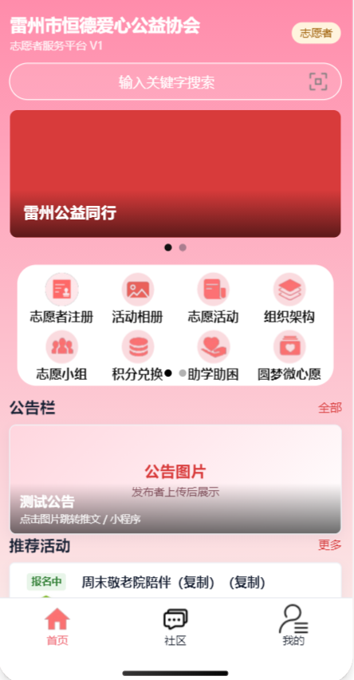
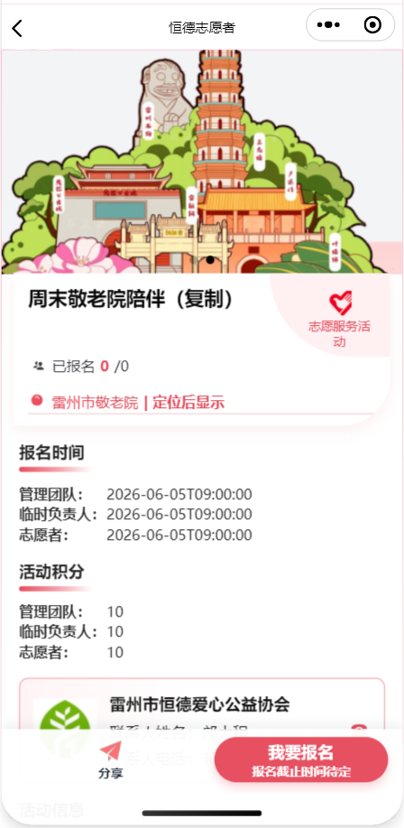
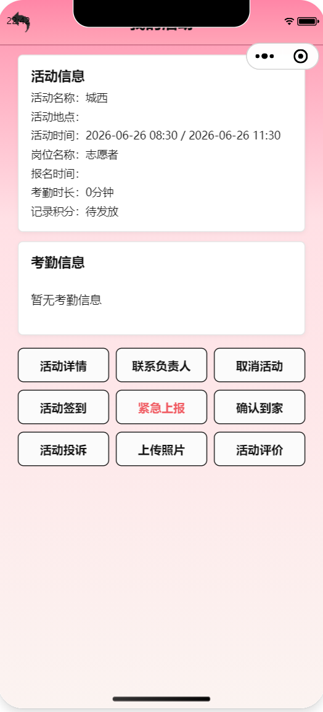
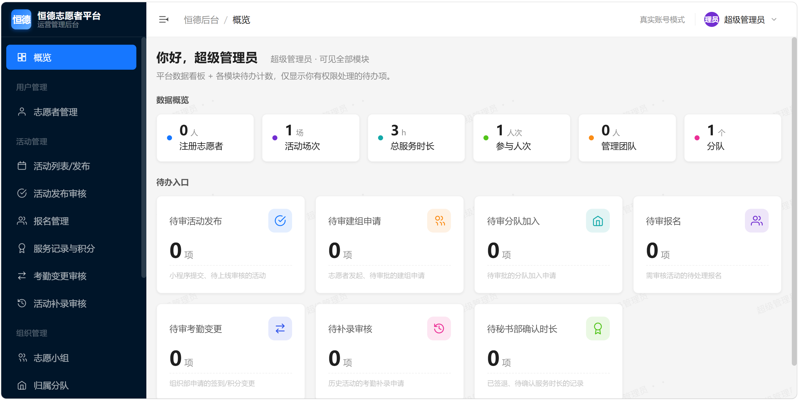
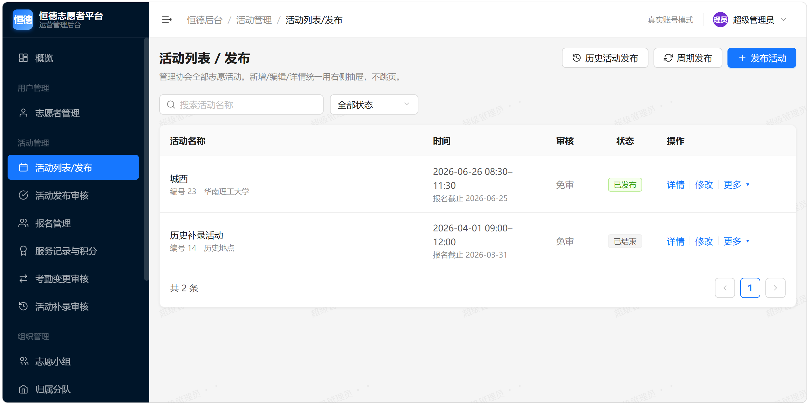
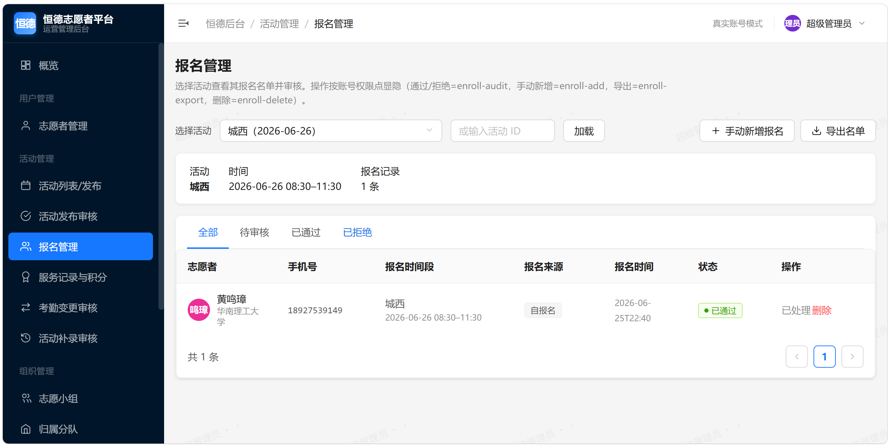
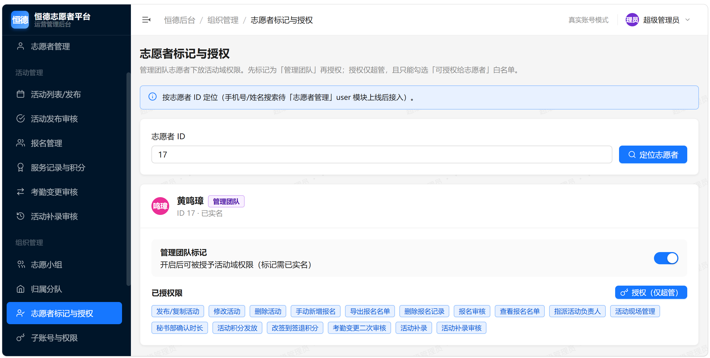
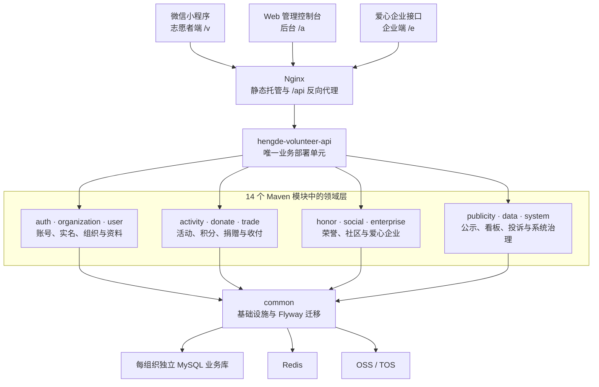

# 恒德志愿者管理平台

> 面向社会公益组织的志愿者服务系统：微信小程序（志愿者端）+ Web 管理控制台 + Spring Boot 4 模块化单体后端。
>
> 为雷州市恒德爱心公益协会设计开发，覆盖实名注册、组织归属、活动发布与按场次报名、扫码与 GPS 签到、服务时长和积分、证书与奖惩、公益捐赠、社区及信息公示等业务。

<p>
  
  
  
  
  
  
  
  
</p>

中文 · **[English README](README.en.md)**

---

## 目录

- [项目简介](#项目简介)
- [功能预览](#功能预览)
- [技术栈](#技术栈)
- [系统架构](#系统架构)
- [功能覆盖](#功能覆盖)
- [工程特点](#工程特点)
- [模块结构](#模块结构)
- [快速开始](#快速开始)
- [工作区结构](#工作区结构)
- [接口与项目文档](#接口与项目文档)
- [项目状态](#项目状态)

---

## 项目简介

平台当前包含三个实际交付部分：

| 部分 | 形态 | 使用者 / 说明 |
|---|---|---|
| 志愿者端 | 原生微信小程序 | 游客、志愿者、活动临时负责人与管理团队志愿者 |
| 管理控制台 | 静态托管的 React 页面，无前端构建链 | 协会各部门、理事会与后台子账号 |
| 业务后端 | Java 17 + Spring Boot 4，14 个 Maven 模块 | 唯一业务部署单元为 `hengde-volunteer-api` |

业务主链为：**实名注册 → 加入小组 / 分队 → 按场次报名 → 扫码与 GPS 签到 → 签退计算时长 → 秘书部确认 → 积分入账与证书生成**。

后端采用领域垂直切分的模块化单体；多组织复用采用**白标多实例**：每个组织独立业务库与配置，运行同一份 api 制品，不在单实例业务表中增加租户字段。

---

## 功能预览

### 微信小程序（志愿者端）

| 首页 | 活动详情与报名 | GPS 签到 |
|:---:|:---:|:---:|
|  |  |  |

### Web 管理控制台

| 数据看板 | 活动管理 | 报名 / 审核 | 子账号与权限 |
|:---:|:---:|:---:|:---:|
|  |  |  |  |

---

## 技术栈

| 分类 | 实际使用 |
|---|---|
| 基础框架 | Java 17 · Spring Boot 4 · Maven Wrapper |
| 认证授权 | Sa-Token：志愿者 `/v`、管理后台 `/a`、爱心企业 `/e` 三套登录态 |
| 持久层 | MyBatis-Plus 3.5.16 · MySQL 8.0.17+ · HikariCP · Flyway |
| 缓存与并发 | Redis · Redisson · `DistributedLockSupport` 分布式锁助手 |
| 对象存储 | 阿里云 OSS / 火山引擎 TOS |
| 第三方能力 | 火山引擎短信 · 腾讯云实名核验 · 微信小程序与微信支付 · 快递100 |
| 文档处理 | EasyExcel + Apache POI · iText · ZXing |
| 接口文档 | springdoc-openapi + Knife4j；生产环境关闭文档入口 |
| 工程化 | Lombok · Hutool · Spring `@Scheduled` · 手写 DTO / VO 转换 |
| 测试 | JUnit 5 · `@SpringBootTest` · Testcontainers MySQL / Redis，不使用 H2 |
| 前端 | 微信原生小程序 · React `createElement` 静态管理控制台 |
| 部署 | Nginx · systemd · 环境变量与生产启动守卫 |

> Spring Cloud / Alibaba、Sentinel、MapStruct、XXL-Job、MinIO 等虽可能出现在历史规划或依赖管理中，但当前代码并未使用，不作为项目实际技术栈宣传。

---

## 系统架构



**架构约定：**

- 父工程只做依赖管理；各领域模块内部包含 `controller / service / dao / entity / dto / vo`。
- 领域之间通过对方 service 接口协作，不直接使用其他领域的 Mapper。
- `common` 持有公共基础设施与业务库 Flyway 迁移；`api` 负责启动、鉴权路由、全局配置和跨域聚合。
- 监管后台是另一个独立应用；V5 规划已完成，但尚未建设，不属于当前业务 Reactor。

---

## 功能覆盖

> “后端已实现”不等于“小程序页面已全部完成”。下表区分当前主要交付边界，详细状态以知识库领域页为准。

| 领域 | 主要内容 | 当前覆盖 |
|---|---|---|
| 账号与组织 | 手机号 / 密码 / 微信登录、实名与协议签名、注销恢复、小组、分队、组织架构、问卷与考试、RBAC | 后端与控制台已覆盖；小程序主要流程已接真实接口 |
| 志愿活动 | 多场次发布、周期 / 历史活动、按场次报名与取消、名额、代报名、签到签退、考勤、名单公示、相册 | 主流程已实现；复杂活动编辑等余项见领域二待办 |
| 积分与商城 | 积分账本、积分中心、商品与规格、卷、兑换、自提 / 快递、核销、企业积分 | 后端与控制台已实现；小程序商城页面仍待补齐 |
| 公益捐赠与收付 | 捐书、微心愿、结对、众筹、捐款发票、物流、微信支付与退款对账 | 业务后端已实现；小程序捐赠页面待补齐；真实支付与物流仍受外部条件限制 |
| 社区与爱心企业 | 帖子、评论、关注、私信、审核风控、举报禁言、企业入驻、赞助商品与评价 | 后端已实现；小程序社区和企业端页面尚未全部接通 |
| 荣誉与个人中心 | 排行榜、勋章、榜样、电子证书、奖惩申诉、志愿者证、地址、安全中心与通知偏好 | 后端与控制台已实现；小程序已有多个对应页面 |
| 信息与系统治理 | 轮播公告、文件网盘、数据看板与汇总、投诉建议、全局搜索、日志、水印与编号 | 后端与控制台已覆盖 |
| 监管后台 | 多组织开通、账号管理、用量配额、跨组织监管与切入组织后台 | **V5 已规划，未建设** |

---

## 工程特点

### 安全与鉴权

- 三套业务登录态互不通用；志愿者请求每次重查账号状态，禁用账号只保留奖惩与申诉等小口子。
- 手机号、身份证等 PII 使用 AES-GCM 密文 + HMAC 查询哈希；日志与公开出参按场景脱敏。
- 短信验证码与后台登录具备 Redis 原子限流、防刷和防爆破；生产弱配置由启动守卫拒绝。
- 上传按目录、权限和文件类型校验，文件头与 MIME 由服务端核验；私有文件使用短期签名地址。

### 一致性与业务建模

- 积分只认 `point_record` 账本，所有读写经 `PointService`，不以活动考勤快照求和。
- 报名、名额、建组、库存、核销等并发入口使用分布式锁、唯一键与 CAS 条件更新。
- 支付到账、退款、证书生成与通知采用幂等事件和补偿任务；第三方回调免登录但验签。
- 数据看板与汇总只调 owner 域只读 service，避免跨模块重复定义统计口径。

### 测试与发布

- 测试统一使用真实 MySQL / Redis 容器，跑真实 Flyway 迁移和 HTTP 路由。
- 关键并发与故障行为要求变异验证；api 全量测试通过才算全量通过。
- `/actuator/info` 提供构建版本、构建时间、源码提交与迁移号，便于核对线上实际制品。
- 知识库包含接口、权限点、表与迁移的脚本生成清单，并提供一致性校验和发布前敏感信息扫描。

---

## 模块结构

| 模块 | 职责 |
|---|---|
| `hengde-volunteer-common` | 基础设施、加解密、对象存储、短信模板、锁助手、Excel、Flyway 迁移 |
| `hengde-volunteer-auth` | 三套登录态支持、实名、PII、处置闸门、通知入口、注销冷静期 |
| `hengde-volunteer-organization` | 子账号与权限、小组、分队、组织架构、管理团队、问卷与临时负责人考试 |
| `hengde-volunteer-publicity` | 轮播图、公告与公示文件 |
| `hengde-volunteer-activity` | 活动、报名、签到、时长、相册、名单公示与积分账本 |
| `hengde-volunteer-trade` | 微信支付、退款与对账；当前真实渠道尚未端到端验收 |
| `hengde-volunteer-donate` | 积分商城、捐书、微心愿、结对、众筹、捐款发票与物流 |
| `hengde-volunteer-user` | 志愿者管理、我的资料、地址、年级、志愿者证与个人中心 |
| `hengde-volunteer-honor` | 排行榜、勋章、榜样、电子证书、奖惩与申诉 |
| `hengde-volunteer-social` | 社区帖子、互动、审核风控、举报禁言与私信 |
| `hengde-volunteer-enterprise` | 企业注册登录、赞助商品、企业积分、企业帖与评价 |
| `hengde-volunteer-data` | 数据看板与汇总、投诉建议 |
| `hengde-volunteer-system` | 操作日志、水印、编号与文件网盘 |
| `hengde-volunteer-api` | 启动、全局配置、鉴权路由、跨域聚合、通用上传与 webhook |

---

## 快速开始

### 环境要求

- JDK 17
- MySQL 8.0.17+
- Redis
- Docker（运行 Testcontainers 集成测试时需要）
- 无需单独安装 Maven，可使用项目自带 Wrapper

### 构建与启动

```bash
cd 代码/hengde-volunteer-parent

# 全量构建：Reactor Summary 应包含 parent + 14 个模块，共 15 行
./mvnw clean install -DskipTests

# 使用 dev profile 启动，需先准备本地 MySQL 与 Redis
./mvnw spring-boot:run -f ../hengde-volunteer-api/pom.xml "-Dspring-boot.run.profiles=dev"
```

启动后默认地址为 `http://localhost:8080`，context-path 为 `/api`。

### 测试与项目校验

```bash
# 某领域模块测试
./mvnw test -f ../hengde-volunteer-activity/pom.xml

# 在文档仓库根执行：知识库生成物与引用检查
python3 tools/gen_knowledge_base.py --check
python3 tools/verify_knowledge_base.py
```

> **本地联调注意**：小程序 `app.js` 与管理控制台默认 API 配置可能指向线上环境，点击会真实写库。本地写操作联调前先改为本机后端；管理控制台使用 `tools/serve_admin_local.py`。生产部署见 `文档/v1/部署说明.md` 与 `部署/`。

---

## 工作区结构

```text
<工作区>/
├── volunteerplatform/                 # 本文档仓库
│   ├── 代码/                          # 后端独立 Git 仓库，14 个 Maven 模块
│   ├── 知识库/                        # 业务口径、决策、模块规则与回归验证
│   ├── 文档/                          # V1–V5 规划、需求、接口与联调记录
│   ├── 部署/                          # Nginx / systemd / 环境变量模板
│   └── tools/                         # 契约、生成、校验与发布脚本
├── volunteerplatform-miniprogram/     # 微信小程序独立仓库
└── volunteerplatform-back/            # 管理控制台独立仓库
```

---

## 接口与项目文档

- 本地 Knife4j：`http://localhost:8080/api/doc.html`；生产环境不提供该入口。
- 接口分组：`volunteer`（`/v/**`）、`admin`（`/a/**`）、`enterprise`（`/e/**`）。
- 历史接口契约：`文档/v1/` 至 `文档/v4/`；脚本生成的现行索引见 `知识库/生成/接口索引.md`。
- 业务入口：`AGENTS.md` 与 `知识库/README.md`。
- V5 监管后台规划：`文档/v5/V5规划.md`。
- 回归方法、最近一次结果与已知缺口：`知识库/回归验证.md`。

---

## 项目状态

- **V1–V4 主体功能已落地**：账号组织、活动与积分、商城捐赠、社区企业、个人中心和系统治理均已有后端实现与相应控制台覆盖。
- **最近一次完整记录（2026-11-01）**：后端 15/15 个 Reactor 项目成功，1176 条用例全部通过；小程序 836 条中 829 通过、7 跳过、0 失败；控制台 119 条 Node 用例通过，另有 58 条 Playwright 用例受本机环境限制未运行。
- **V5 监管后台已完成规划、尚未开工**：规划为独立控制面与组织侧受控连接器，不改变现有业务库的多实例隔离方式。
- **仍有外部验收边界**：微信支付、快递100、服务号模板消息、小程序码与对象存储视频直传等不能仅凭本地用例宣称已经真实打通。
- **冻结 / 推迟项**：纸质证书、i志愿证书、仓库管理、评优评先等，按对应领域页和协会问题单处理。

最新状态以 `知识库/领域/`、`知识库/变更日志.md` 与 `知识库/回归验证.md` 为准；README 只作为项目入口，不替代持续更新的知识库。

---

<sub>本项目为个人独立开发的公益组织管理平台。更多需求、决策、实现与验证细节请查阅 `知识库/` 和 `文档/`。</sub>
